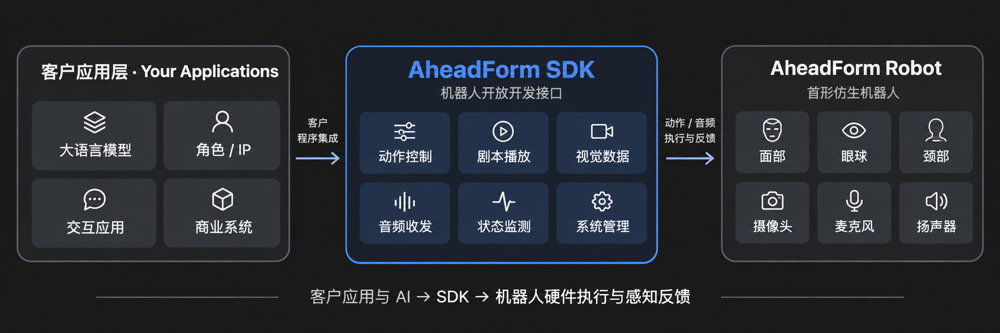

# AheadFormSDK

**Build Your Own Embodied AI.**  
让你的 AI 拥有真实的面孔、声音、眼神与表达能力。

AheadFormSDK 是首形科技（AheadForm）面向仿生机器人提供的开放软件开发工具包。它通过标准化的运动控制、剧本演绎、音视频和设备状态接口，连接客户自己的 AI 模型、数字角色、交互内容及业务系统与首形仿生机器人。

客户既可以使用首形提供的智能交互系统（视产品配置而定），也可以通过 SDK 自主开发上层应用，将自己的智能和内容带入真实世界。

## How It Works ｜ 整体架构



SDK 是连接智能应用与机器人硬件的桥梁：客户应用通过 SDK 下发动作、剧本与音频，机器人通过 SDK 返回摄像头、麦克风及设备状态数据，形成感知与表达的闭环。

## Use Cases ｜ 应用场景

基于AheadFormSDK的开放接口，用户可进一步开发的应用方向：

| 应用方向 | 典型场景 |
| :--- | :--- |
| **AI Agent** · AI 实体化 | 将客户自己的 AI 助手接入实体机器人 |
| **Research & Education** · 科研教育 | 人机交互、具身智能、心理学与认知科学 |
| **Robotics Integration** · 本体集成 | 与人形机器人本体或其他控制系统进行适配 |
| **IP & Character** · IP 角色 | 打造具有独立人格、声音与表达风格的实体角色 |
| **Entertainment** · 文娱演出 | 唱歌、舞台表演、互动娱乐 |
| **Retail & Exhibition** · 商业展陈 | 商场迎宾、品牌展示、展馆讲解 |


## Getting Started | 快速开始

在客户的 Linux 电脑上用 `PlayScript` 播放本地剧本：动作 CSV 必填，可另指定 MP3 或 PCM WAV，无需同名。SDK 通过 DDS 发送脸部、眼睛和脖子动作，通过 RTP/UDP 发送音频。剧本文件保留在客户电脑上，不上传到机器人。播放机器人上已有的资源时，使用 `EmotePlayback`。

SDK 还提供音量查询、动作控制、状态与故障读取、音频设备管理等菜单示例。C/C++ 客户可扩展工程或独立使用 API 库；Python 客户通过 CFFI 复用同一份 C API 和 User 菜单业务。部署步骤和全部 17 条指令见 [AheadFormSDK 快速上手](doc/AheadFormSDK快速上手.md)。

## 文档索引

| 文档 | 用途 |
| --- | --- |
| [文档与代码清单](doc/文档与代码清单.md) | 各目录、文档和代码入口的用途 |
| [AheadFormSDK 快速上手](doc/AheadFormSDK快速上手.md) | 部署、配置、全部菜单指令和工程移植 |
| [AheadFormSDK 架构设计说明](doc/AheadFormSDK架构设计说明.md) | 模块职责、DDS 与媒体通路、错误码和构建方式 |
| [依赖部署与交叉编译](doc/依赖部署与交叉编译.md) | 编译器选择、私有 DDS、离线部署及交叉编译 |
| [Python 接入说明](python_demo/doc/Python接入说明.md) | API 调用、User 菜单复用、Python 构建与运行 |
| [第三方依赖说明](ThirdParty/README.md) | CycloneDDS 源码版本、来源、许可证及校验 |
| [CSV 剧本格式要求](doc/CSV剧本格式要求.md) | 动作 CSV 的字段、单位和文件要求 |
| [AheadFormSDK 特点说明](doc/AheadFormSDK特点说明.docx) | SDK 特点与使用方式说明（Word） |
| [SDK 剧本播放方法操作示例](doc/SDK剧本播放方法操作示例.mp4) | 客户端剧本播放的操作演示（视频） |

仓库的 [`scripts`](scripts/) 目录提供示例动作 `AheadForm_standard_demo_52.csv` 和配套音频 `AheadForm_standard_demo.mp3`，可按第 5 节直接播放。文档中的 `show.csv` 和 `voice.mp3` 为客户自备文件的示例名称。

## 1. 准备环境

AheadFormSDK 面向 GNU/Linux，可针对 **32 位和 64 位 Linux** 从源码构建。C/C++ 已在 Ubuntu 22.04 验证 x86_64 原生构建，以及 ARM64 和 ARM32（armhf）交叉构建。平台支持以现有 GNU/Linux 接口、依赖及工具链的实际能力为准；Python 接入还需要匹配的目标 Python/CFFI 环境，当前未完成 ARM32/ARM64 Python 实机验证。当前不提供 Windows/macOS 原生运行方式。

运行 SDK 时，电脑与已启动的机器人连接可互通的有线局域网；Linux 虚拟机使用桥接有线网卡。部署环境时无需连接机器人。已有依赖满足要求时不安装，缺少系统包时才需要联网和 sudo 权限；DDS 和 SDK 使用普通用户构建。

## 2. 下载、安装依赖并编译

以下命令在客户的 Linux 电脑执行，示例将工程放在用户主目录：

```bash
cd ~
git clone https://github.com/AheadForm/AheadFormSDK.git
cd ~/AheadFormSDK
bash deploy/deploy.sh
```

脚本显示当前 C 编译器；直接回车或等待 2 分钟保留当前值，需要指定时输入编译器名称或完整路径。配套 C++ 编译器和静态库工具通常自动确定，也可通过环境变量指定。确认后的参数保存在项目本地配置中，后续 Makefile 自动读取；客户配置入口为 [`deploy/deps.mk`](deploy/deps.mk)。

脚本检查构建工具、GStreamer Core/App ≥ 1.20 和实际所需插件，APT、DNF、Zypper 系统缺少依赖时安装或升级必要包；Arch 等其他系统需先自行准备报告的缺项。CycloneDDS 11.0.1 源码已随包放在 `ThirdParty/`，部署时使用所选工具链构建到私有 `.deps/` 目录，SDK 静态链接这份 DDS，不安装或替换系统 DDS，也不修改全局动态库搜索配置。GStreamer 使用客户环境，必要的系统包安装可能升级已有的 GStreamer 1.x。

默认还会在 `python_demo/.venv` 准备 Python/CFFI 环境；不需要 Python 时加 `--skip-python`。Python 环境准备失败不阻止 C/C++ 依赖部署，脚本最后分别显示两种环境的准备结果。

**部署只准备依赖，不编译 SDK 主程序或 Python 扩展。** 同一套工具链和依赖只需成功部署一次，中断后可重新执行；之后按第 4 节选择客户语言手动构建。默认保留机器人配置，也可选填 `--robot`、`--domain`、`--interface` 更新相应字段；运行前仍须核对配置。仓库当前的机器人 IP `192.168.110.36`、外部 DDS 域 `14` 和网卡 `ens33` 均需按现场修改。

只随包提供 DDS 源码，GStreamer、工具链、构建工具和 Python 依赖包需提前准备。依赖完整时可用 `--skip-packages` 跳过系统包操作；离线安装 Python 包还需 `--python-wheelhouse /本地包目录`，`--skip-packages` 本身不禁止 pip 联网。交叉编译使用目标 sysroot、GStreamer 和 Python 开发环境，详见[依赖部署与交叉编译](doc/依赖部署与交叉编译.md)。原 `deploy/deploy_ubuntu.sh` 保留为兼容入口。

## 3. 配置放在哪里、怎样修改

```text
~/AheadFormSDK/
├── deploy/
│   ├── deploy.sh                  ← 统一部署入口
│   ├── deploy_ubuntu.sh            ← 兼容入口
│   └── deps.mk                     ← 编译与依赖配置入口
├── ThirdParty/                    ← 随包 CycloneDDS 源码
├── python_demo/                   ← Python 构建、示例和接入文档
└── CodeProject/
    ├── Makefile
    ├── AheadFormSDK_Config.ini     ← 有效配置文件
    └── AheadFormSDK                ← 编译生成的程序
```

在 Linux 终端打开配置：

```bash
cd ~/AheadFormSDK
nano CodeProject/AheadFormSDK_Config.ini
```

| 配置 | 应填写的内容 |
| --- | --- |
| `[dds].strNetworkInterface` | 客户电脑的本地有线网卡，DDS 与媒体共用 |
| `[dds].domain_id` | 机器人 DDS Bridge 对外通信域，当前示例为 `14` |
| `[media].strRobotIPv4` | 机器人音频接收目标 IPv4，当前示例为 `192.168.110.36` |
| `[media].spkPort` / `spkPayloadType` | 与机器人扬声器 RTP 配置一致，示例 `5604` / `96` |

将 `ip -4 route get 192.168.110.36` 中的 IP 换成实际值，可查看到机器人的本地路由网卡。核对 [AheadFormSDK_Config.ini](CodeProject/AheadFormSDK_Config.ini)，保留文件中的必需项，按现场配置调整；这里的网卡是运行 SDK 的客户电脑网卡。修改后重启程序即可，无需重新编译。完整字段和取值范围见[配置字段说明](doc/AheadFormSDK快速上手.md#配置字段说明)。

## 4. 手动编译与启动菜单

部署完成后，按客户语言选择一种构建方式即可。C/C++ 客户在 Linux 终端编译：

```bash
cd ~/AheadFormSDK/CodeProject
make
ldd ./AheadFormSDK
```

重新链接成功时输出 `CREATE AheadFormSDK`；`ldd` 不应出现 `not found`。确认机器人已上电至少 10 秒，再启动 SDK：

```bash
cd ~/AheadFormSDK/CodeProject
./AheadFormSDK
```

**C/C++ 程序从当前工作目录读取 `AheadFormSDK_Config.ini`，因此需要进入 `CodeProject` 后运行。** 该入口没有 `--config` 参数，也不能直接把 CSV 路径作为可执行程序的启动参数。

启动成功后看到 `>>` 提示，在 **SDK 菜单中**输入以下指令并回车：

```text
help
```

等到 `>>` 再次出现后，可继续输入指令。菜单中的 `<...>` 是示例，输入时只键入尖括号里的内容。

Python 客户在 `python_demo` 构建并启动，无需先构建 C/C++ 主程序：

```bash
cd ~/AheadFormSDK/python_demo
make
.venv/bin/python demo_user.py
```

Python 菜单先完成 SDK 初始化，再显示 `>>`，复用原 User 命令与执行结果打印；输入 `help` 查看指令，`exit` 退出。仅使用 API 时执行 `make api`，再运行 `.venv/bin/python demo_api.py`；详细调用方式见 [Python 接入说明](python_demo/doc/Python接入说明.md)。

日常修改或新增源码后，在所选构建目录重新 `make` 即可。C/C++ 主 Makefile 自动收集 `CodeProject` 下除 `API` 外各级目录的 `.c`、`.cpp`，新增源码无需修改 Makefile；API 保持纯 C。整个程序只保留一个 `main()`，同目录不能同时存在 `foo.c` 和 `foo.cpp`。删除、重命名或转换源码类型后先 `make clean`；更换编译器或参数时，先重新部署，再在对应目录执行 `make clean && make`。Python 目录的 `clean` 会同时清理标准 API 产物，保留 DDS 缓存和虚拟环境。

## 5. 放置并播放客户剧本

从 `CodeProject` 启动 C/C++ SDK，或从 `python_demo` 启动 Python 菜单后，输入以下指令播放仓库附带的示例剧本：

```text
PlayScript ../scripts/AheadForm_standard_demo_52.csv
PlayScript ../scripts/AheadForm_standard_demo_52.csv ../scripts/AheadForm_standard_demo.mp3
```

将符合规定格式的动作 CSV 放在 Linux 客户端的可读目录中。需要配音时，再准备一个 MP3 或 PCM WAV。文件不必放在 SDK 目录中。

在 SDK 菜单中，按需选择其中一条指令，将路径换成自己的文件：

```text
PlayScript /home/customer/AheadFormScripts/show.csv
PlayScript /home/customer/AheadFormScripts/show.csv /home/customer/AheadFormScripts/voice.mp3
```

C/C++ 菜单的文件路径请使用不含空格的名称；Python 菜单支持带引号的含空格路径。输入路径不会展开 `~` 或 `$HOME`。如现场需要先切换到开发模式，在播放前输入 `OperatingMode dev`。`PlayScript` 返回后可继续输入下一条指令，或输入 `exit` 退出。

带音频时，示例默认在客户端提交首帧 PCM 后延迟 150 ms 开始发送动作。实际声画时序还受网络、缓冲和机器人执行影响。动作文件的字段和单位见 [CSV 剧本格式要求](doc/CSV剧本格式要求.md)。

播放机器人上已有的资源时，使用 `EmotePlayback`，传入机器人上的文件名；暂停、继续或停止这类播放使用 `EmotePlayCtrl`。

## 6. 其它主要功能

以下均为启动 SDK 后输入的菜单指令；完整参数和输入示例见《快速上手》第 3 章。

| 功能 | 指令 |
| --- | --- |
| 客户端剧本播放 | `PlayScript` |
| 机器人端资源播放 | `EmotePlayback`、`EmotePlayCtrl` |
| 音量查询 | `QueryVolume`、`WatchVolume` |
| 动作控制 | `Tx1MotionPose`、`Tx1Face`、`Tx1NeckPose`、`TxServosTargetLogicDeg` |
| 状态与故障 | `ReadRecentState`、`WatchState` |
| 音频设备 | `AudioDevice` |
| 工作模式 | `OperatingMode` |
| 帮助与诊断 | `help`、`errlog`、`shell`、`exit` |

各功能需要机器人相应服务及 DDS Bridge/RTP 通路。`WatchVolume`、`WatchState` 和 `PlayScript` 返回后才能输入下一条指令。麦克风与视频 Reader、PCM 发送通过 SDK API 使用。

SDK 源码与公开头文件位于 `CodeProject/API/`，菜单调用示例位于 `CodeProject/User/`，Python 示例位于 `python_demo/`，部署脚本位于 `deploy/`。API 默认构建静态库，API 子 Makefile 的 `api_so` 目标按需生成 `libAheadFormSDKApi.so`；Python 构建自动复用这份动态库。在自己的工程中链接 API 库的方法见 [AheadFormSDK 快速上手](doc/AheadFormSDK快速上手.md)，各目录用途见[文档与代码清单](doc/文档与代码清单.md)。许可证见 [LICENSE](LICENSE)。
