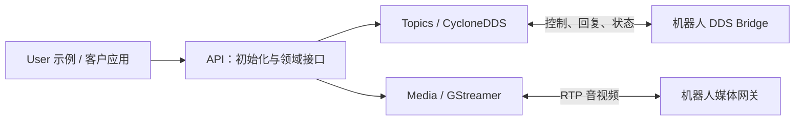

# AheadFormSDK 架构设计说明

本文介绍当前 Linux C SDK 的分层、构建和调用约定，供接入 SDK 或维护源码时查阅。部署、启动和完整指令菜单见[《AheadFormSDK 快速上手》](AheadFormSDK快速上手.md)。

## 1. API 与 User 的职责

**`CodeProject/API` 提供可复用的 SDK 能力。** 它负责解析配置、管理连接与资源、校验业务参数、发布控制、接收状态和回复、处理音视频及本地文件。API 不依赖终端菜单。应用可以链接 API 静态库，按自己的业务流程组合这些接口。

**`CodeProject/User` 是可运行的客户端示例。** [`main.c`](../CodeProject/User/main.c) 初始化 SDK、运行菜单并处理退出；[`HandleUserInCmd.c`](../CodeProject/User/HandleUserInCmd.c) 解析终端输入并分派指令；[`UserCmdMenu.c`](../CodeProject/User/UserCmdMenu.c) 把 API 组合成音量查询、状态观察、剧本播放等业务流程。客户可扩展 `User`，也可在自己的工程中复用相应业务函数及其辅助代码。

| API 模块 | 职责 |
| --- | --- |
| [`Task`](../CodeProject/API/AheadForm_Task/Task/AheadForm_Task.h)、[`ParseInitConfig`](../CodeProject/API/AheadForm_Task/ParseInitConfig/ParseInitConfig.h) | 定义总句柄，解析 INI，组合各模块的初始化和释放，提供通用 Reader / Writer 注册入口。 |
| [`topic`](../CodeProject/API/AheadForm_Task/RobotCtrl/topic/AheadFormTopics.h) | 管理 DDS 实体、Topic 名称与 QoS、共享接收缓存、Reader / Writer、回复匹配和回调分发。 |
| [`head`](../CodeProject/API/AheadForm_Task/RobotCtrl/head/Head.h) | 发送完整动作、面部、颈部和脸部舵机目标；动作文件加载与插值由同目录的 `HeadMotionFile` 提供。 |
| [`media`](../CodeProject/API/AheadForm_Task/RobotCtrl/media/Media.h) | Audio 通过 DDS 管理音量与音频设备，通过 RTP 获取麦克风数据、发送扬声器 PCM；Video 通过 RTP 获取视频。`AudioFile` 负责本地音频文件解码。 |
| [`status`](../CodeProject/API/AheadForm_Task/RobotCtrl/status/Status.h)、[`operating_mode`](../CodeProject/API/AheadForm_Task/RobotCtrl/operating_mode/OperatingMode.h) | 读取传感器、颈部、故障池状态；查询和请求切换机器人工作模式。 |
| [`emote_play`](../CodeProject/API/AheadForm_Task/RobotCtrl/emote_play/EmotePlay.h) | 请求机器人播放已有资源，执行暂停、继续和停止，接收控制回复及播放事件。 |
| `common` | 提供 DDS 基础封装、错误栈、环形缓冲区、时间、INI 和文件操作等公共代码。 |

## 2. 连接、资源和退出

`AHEADFORM_ALL_CTRL` 由应用提供存储，内含解析后的配置、Topics 和各领域子句柄。它包含较大的内嵌接收缓存，示例使用静态存储。活动句柄不得按值复制或搬移；即使结构体可见，也不要直接修改 SDK 管理的字段。

- `AheadForm_Init()` 的顺序是配置 → Topics → Head → Media → Status → OperatingMode → Emote；成功后才调用运行接口。`AheadForm_Deinit()` 按相反顺序执行。SDK 入口按模块逐步执行并返回首个失败，没有总句柄级的自动回滚。示例在初始化失败时打印错误并退出；接入时不要把部分初始化的句柄当作可用句柄继续调用或直接重试。
- 初始化和释放须串行。正常退出前，应用先停止发请求、收数据的线程和事件循环，结束未完成的异步登记，注销自己注册的 Reader / Writer，再释放 SDK。媒体模块要求在释放前注销客户 MIC / Video Reader；实际释放开始后若失败，应按模块接口契约处理，不继续使用已经部分释放的句柄。
- [`AheadFormSDK_Config.ini`](../CodeProject/AheadFormSDK_Config.ini) 的 `[dds]` 指定客户端网卡和机器人**外部** DDS 域；`[head]` 的 `sourceName` 标识动作控制来源；`[media]` 配置机器人 IP、组播、端口、负载类型和媒体启动开关。这些参数应与目标机器人一致。示例从当前工作目录读配置，自有应用可给 `AheadForm_Init()` 传入明确路径。
- 当前 Topic 表配置了 17 个 DDS 端点。SDK 在初始化时等待匹配外部端点，仅与本进程实体匹配不算发现成功。机器人未就绪、外部域不匹配或链路异常都可能使初始化返回并记录 `ERR_DDS_DISCOVERY_TIMEOUT`。发现端点也不表示所有状态都有样本：不少机器人没有接入 IMU，`sensor` 为空或长期无更新可能是正常的。

## 3. DDS 通路和接收方式

发送时，领域模块把 SDK 参数转换成与 Topic 匹配的 DDS 样本；`TopicWriter_Write()` 成功表示本地发布成功。接收时，DDS 监听函数把有效样本转换成 SDK 数据，放入该 Topic 的共享环形 FIFO，再完成异步回复匹配、发出 Reader 数据通知并依注册顺序执行回调。DDS 消息的类型定义来自 [`AheadFormMsg.idl`](../CodeProject/API/AheadForm_Task/RobotCtrl/topic/idl/AheadFormMsg.idl)，Topic 名称、方向和 QoS 以 [Topic 描述表](../CodeProject/API/AheadForm_Task/RobotCtrl/topic/AheadFormTopics.c) 为准。

同一 Topic 的多个 SDK Reader 共享样本存储，但各有独立读游标、通知和漏读计数。注册 SDK Reader 不会为每个调用方再创建一个原生 DDS DataReader。缓存有容量上限，慢消费者可能错过已被覆盖的样本。

| 场景 | 方式 | 用途 |
| --- | --- | --- |
| 持续接收状态、回复或媒体帧 | Reader 的 `rxDataUpdateEventfd` | 把多个接收源放到应用自己的 `poll` / `select` 循环，再从各 Reader 取数据。通用 DDS Reader 收到该 Topic 的数据，由调用方自行筛选。 |
| 发出请求并等对应回复 | 异步请求的 `notifyEventfd` | SDK 按请求标识匹配并把回复直接写入调用方缓冲区；适合一个事件循环管理多个请求。 |
| 样本到达后马上做少量工作 | DDS `ReaderCallback` | 在接收路径做轻量筛选、复制或通知应用线程；适合自己维护接收逻辑。 |
| 偶尔查看状态，不需连续接收 | `Status_ReadLatest*()` / `Status_Read*Recent*()` | 直接复制已有快照，不发布查询，也不推进 Reader 游标。缓存为空返回 0；有缓存并不证明当前仍在线。 |

### 3.1 数据通知：`rxDataUpdateEventfd`

这是代码中 Reader 的数据更新通知字段。fd 由 SDK 在注册时创建、注销时关闭。应用可以等待和读取通知，不能自行关闭，也不能代替 SDK 操作领域模块的内部 Reader。多个业务消费者各自注册 Reader；同一个 Reader 由一个消费者串行等待和读取。

典型顺序：注册 Reader → 等待 fd 可读 → `eventfd_read()` 清除通知 → 按 `TopicReader_PopElem()` 或对应媒体 Pop 接口的返回值取数据。先清通知再读 FIFO；计数只是更新提示，不能当作帧数或回复数。单条 Pop 返回 `1` 时输出才有效，`0` 表示暂时没有可交付数据，负值按接口错误处理。若限制单次处理数量，重新等待前应检查是否还有未读数据。

以 `QueryVolume` 为例：构造请求，注册 `Audio_RegisterVolumeReader()`，发送前准备好 Reader；通知到来后取出回复，用 `Audio_MatchVolumeReplyWithReq()` 比对请求，再调用 `Audio_GetVolumeFromReply()` 读取音量。当前菜单的默认实现就是这一路径。

### 3.2 异步请求：登记、匹配和完成通知

使用 `Audio_QueryVolumeAsync()` 等领域接口时，SDK 会先在内部 Reader 登记匹配条件，再发布请求，避免漏掉立即到达的回复。使用通用 `TopicReader_RegisterAsyncRequest()` 时，应用自己负责先登记再发送。不同领域的匹配字段可能不同，例如音量匹配来源名、请求号和操作类型，Emote 回复匹配请求号。

1. 每个在途请求使用独立的回复缓冲区和一个空的 `eventfd(0, EFD_NONBLOCK | EFD_CLOEXEC)`。完成 fd 由应用负责关闭。SDK 复制匹配参数，不接管回复缓冲区；通用接口最多复制 128 字节，每个 Reader 有 6 个登记槽。
2. 匹配成功时 SDK 先写回复再通知。fd 可读后可以取回复；也可先用相应的 `Check...()` 查询，返回 `1` 表示匹配到回复、`0` 表示还在等待。`Check...()` 不读 fd，若需要调用，应在清除完成通知前查询。
3. 请求超时不会写完成 fd。`poll` / `select` 超时只说明此次等待结束；释放回复缓冲区和关闭 fd 前，要确认匹配已完成、`Check...()` 返回 `ERRCODE_REQUEST_TIMEOUT`，或 `Cancel...()` 成功。取消只结束本地登记，机器人可能仍会处理已发送的请求。

如果只需要在当前线程等一次回复，可用 `Audio_QueryVolumeAndWaitReply()` 或各领域的 `...AndWaitReply()` 包装。异步匹配期限用微秒，等待包装的 `timeout_ms` 用毫秒；后者是相对等待时长，不能作为包含初始化、发布或清理在内的整次调用时限。

要区分三件事：**本地提交成功、收到匹配回复、机器人业务成功。** 收到匹配回复后依然要检查 `retCode` / `result`；对于 Emote，起播回复成功也不代表已经播完，持续观察用独立的 Event Reader。

### 3.3 回调：`ReaderCallback`

注册 `AHEADFORM_TOPIC_READER_PARA` 时填写 `ReaderCallback` 与 `pUserArg`。DDS 接收路径在 Topic 锁内同步调用回调。回调拿到的是当前 FIFO 元素的临时只读指针，离开回调后不能继续使用；需要跨线程使用时复制数据，再通知自己的工作线程。回调只做短操作，不在里面等待回复、执行阻塞 IO、注册或注销 Reader，或调用会再次获取 Topic 锁的接口（例如 `TopicReader_ReadRecentElems()`）。

`pUserArg` 指向的数据要在注册前准备好，直到成功注销、正在执行的回调结束后才可释放。用业务回调做回复筛选时，可以参照 `UserCmdMenu.c` 的 `CopyVolumeReplyIfMatchesReq()`：应用自己做匹配、复制，并用自己的完成 fd 通知等待线程。回调不会推进 Reader 的 FIFO 游标。

### 3.4 对照现有菜单实现

| 源码入口 | 可对照的实现 |
| --- | --- |
| `QueryVolume()`、`WatchVolume()`、`AudioDevice()`、`OperatingMode()` 的设置分支、`EmotePlayCtrl()` | `USER_CMD_REPLY_METHOD`：`1` 为 Reader 通知加手动匹配（默认），`2` 为异步请求，`3` 为业务回调。 |
| `WatchState()` | `USER_CMD_STATUS_RX_METHOD`：`1` 为 Reader 通知（默认），`2` 为回调。两者都用于观察新收到的状态。 |
| `EmotePlayback()` | 分别登记控制 Reply 和一条未来播放 Event。Event 要在发送 PLAY 前登记才能捕获早到的事件；登记本身不发状态查询，也不等待播放结束。 |

## 4. 媒体、文件和时间

| 通路 | 应用取得或提交的数据 |
| --- | --- |
| [`Audio` 麦克风](../CodeProject/API/AheadForm_Task/RobotCtrl/media/Audio.h) | 从机器人组播 RTP 获取麦克风副本。`Audio_MicReader_PopFrame()` 每次取一帧 16 kHz、单声道、S16LE PCM（640 字节，20 ms）。接收不会改变机器人当前设备路由。 |
| [`Video` 视频](../CodeProject/API/AheadForm_Task/RobotCtrl/media/Video.h) | 接收组播 RTP/H.264，`Video_Reader_PopFrame()` 输出一个 Annex-B H.264 AU（编码后的访问单元）。启动前配置 `videoFrameSizeMax`，接收缓冲区至少达到这个容量；新 Reader 或已知丢帧后等待带 SPS/PPS 的 IDR 恢复。 |
| `Audio` 扬声器发送 | `Audio_WriteSdkPlayPcm()` 每次提交一帧 640 字节 S16LE PCM，经 GStreamer 封装 RTP/L16 单播给机器人。队列有上限，写入成功仅表示本地入队。 |

MIC 和 Video 在首次成功 Start 后注册 Reader，可同时注册独立消费者。Stop 保留 Reader 和缓存，整个 SDK 退出前仍要注销应用登记的 Reader。当前 SDK 提供采集和发送，客户可自行将数据接入模型、组合或保存。

- **本地播放：** `Head_LoadMotionCsv()` 和 `Audio_DecodeFileToPcm()` 使用调用方提供的缓冲区；`User` 的 `PlaybackScriptOfUser()` 读取本地文件，通过 `timerfd` / `select` 按 20 ms 周期组织发送。指定音频时，示例默认在首帧 PCM 提交后延迟 150 ms 启动动作。这是示例的起播安排，不能代替实机声画测量。函数复用静态缓冲区，只支持串行调用。动作文件字段和单位可参考[《CSV 剧本格式要求》](CSV剧本格式要求.md)。
- **机器人端播放：** `EmotePlayback` 发请求给机器人，菜单使用机器人已有的完整资源名（含后缀）。它与读取客户端文件的 `PlayScript` 是两条独立通路。
- **时间边界：** `ReceiveTime_us` 是 SDK 本机的单调接收时间，媒体的 `pts_ns` 是流时间（不可用时为 `ULLONG_MAX`），CSV 的 `timestamp` 是剧本相对时间。它们的起点、单位和用途不同，不能直接当作跨设备的统一时间轴。

## 5. 错误码与错误栈

[`Error.h`](../CodeProject/API/common/Error.h) 为同一个错误提供两种宏，数值相同，副作用不同：

| 用法 | 写法 |
| --- | --- |
| 在发现错误处记录函数和行号，再返回错误码 | `return ERR_ARGV_2;` |
| 比较返回值，或返回接口约定的无日志状态 | `ret == ERRCODE_REQUEST_TIMEOUT` |
| 向上层传递已产生的错误 | `return ret;`，避免重复记录同一个错误 |

`ERR_*` 通过 `SaveErrLog()` 尝试写入进程内共享错误栈。栈定长（119 条），并发写入冲突或栈满时仍返回同一错误码，可用 `GetDroppedErrLogCntForBusy()` / `GetDroppedErrLogCntForFull()` 查看丢弃数。应用可用 `PrintAllErrLog()` 查看快照或用 `StoreAllErrLogToFile()` 导出，菜单提供 `errlog`。返回指针等非错误码类型的接口可按契约返回 `NULL` 等结果，并用 `PRINT_FUNCTION_ERRINFO()` 打印诊断。

**按故障所在的层判断是否记录。** 例如初始化发现超时、菜单请求超时、板端拒绝造成业务指令失败时，会在相应位置用 `ERR_DDS_DISCOVERY_TIMEOUT`、`ERR_REQUEST_TIMEOUT` 或 `ERR_REQUEST_REJECTED` 记录。底层逐条比较回复时，遇到其他请求的回复是正常情况，返回不入栈的 `ERRCODE_MATCH_REPLY_WITH_REQ_FAIL`；异步 `Check...()` 用 `ERRCODE_REQUEST_TIMEOUT` 报告已无待匹配结果，由业务层决定如何处理。传入零等待时长等非法参数应按对应 `ERR_ARGV_*` 处理。

`RET_SUCCESS` 为 `0`，但对 Pop、快照读取和异步检查等接口，`0` 可能表示无数据或仍在等待，正值也可能表示数量或完成状态。判断返回值要按具体接口契约，不能把全 SDK 的非零返回都当成错误。

错误分为三组：第 0 组通用错误，第 1 组 I/O 与进程间通信，第 2 组 SDK 业务与客户自定义。第 2 组 `0～6` 已使用，`7～27` 留给客户。新增业务错误时从 `7` 开始连续分配成对的 `ERR_*` / `ERRCODE_*`，并在 [`Error.c`](../CodeProject/API/common/Error.c) 的 `gErrNameMap` 对应组按槽位追加名称。只加宏而不登记表项不能正常入栈。调用方用宏比较，SDK 库与调用方统一使用配套头文件重新构建。

## 6. 全自动 Makefile 与交付方式

| 构建入口 | 扫描范围 | 产物 |
| --- | --- | --- |
| 从 SDK 根目录运行 `make -C CodeProject`，或在 `CodeProject` 中运行 `make` | `CodeProject` 下全部 `.c`，包含 API、生成的 DDS C 文件和 User | `CodeProject/AheadFormSDK` |
| 在 `CodeProject/API` 运行 `make -f subMakefile_buildApiLib` | `API` 下全部 `.c` | `CodeProject/API/libAheadFormSDKApi.a` |

两个 Makefile 都从当前工作目录递归发现目录和 `.c`，不要求 `src` / `inc`。每个目录通过 `-I` 提供给编译器查找头文件；`-MMD -MP -MF` 将编译时实际用到的头文件写入源码旁的隐藏 `.o.d`，下次 `make` 读取这些依赖决定是否重编。`-I` 负责**找到头文件**，`.o.d` 负责**跟踪变更**。新增源文件或修改头文件不需要维护清单；源码搜索范围内每个 `.c` 都会参与编译。

在 `User` 内扩展时可创建多级目录，整个程序只保留一个 `main()`。同一入口下普通 `make` 会增量构建；删除或重命名 `.c`、变更编译器或参数后先清理再构建。程序与静态库共用源码旁的 `.o` / `.o.d`，而依赖路径的基准不同，切换入口时先用目标入口的 `clean` 清理：切到主程序用 `make -C CodeProject clean`，切到静态库在 `API` 中运行 `make -f subMakefile_buildApiLib clean`。

静态库只归档 API 对象。客户工程将 API 头文件目录加入搜索路径，把库放在调用方对象文件之后，再链接 CycloneDDS、GStreamer App、`pthread`、`m`、`rt`。主构建检查 GStreamer Core 和 App 开发包的最低版本为 1.20；静态库入口还检查 CycloneDDS 包是否存在。Ubuntu [部署脚本](../deploy/deploy_ubuntu.sh) 使用 CycloneDDS 11.0.1，检查媒体插件后全量构建和检查动态库，再备份并更新配置。
